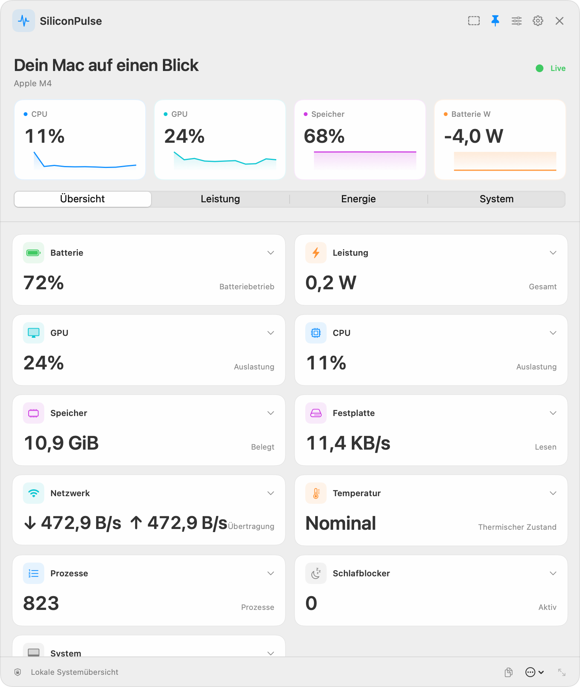
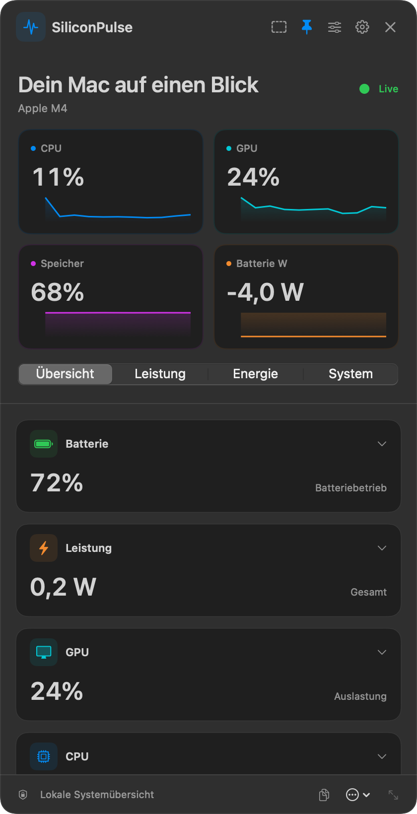
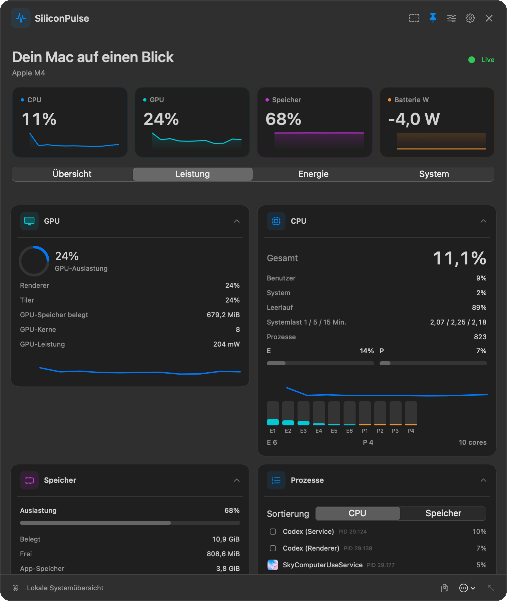
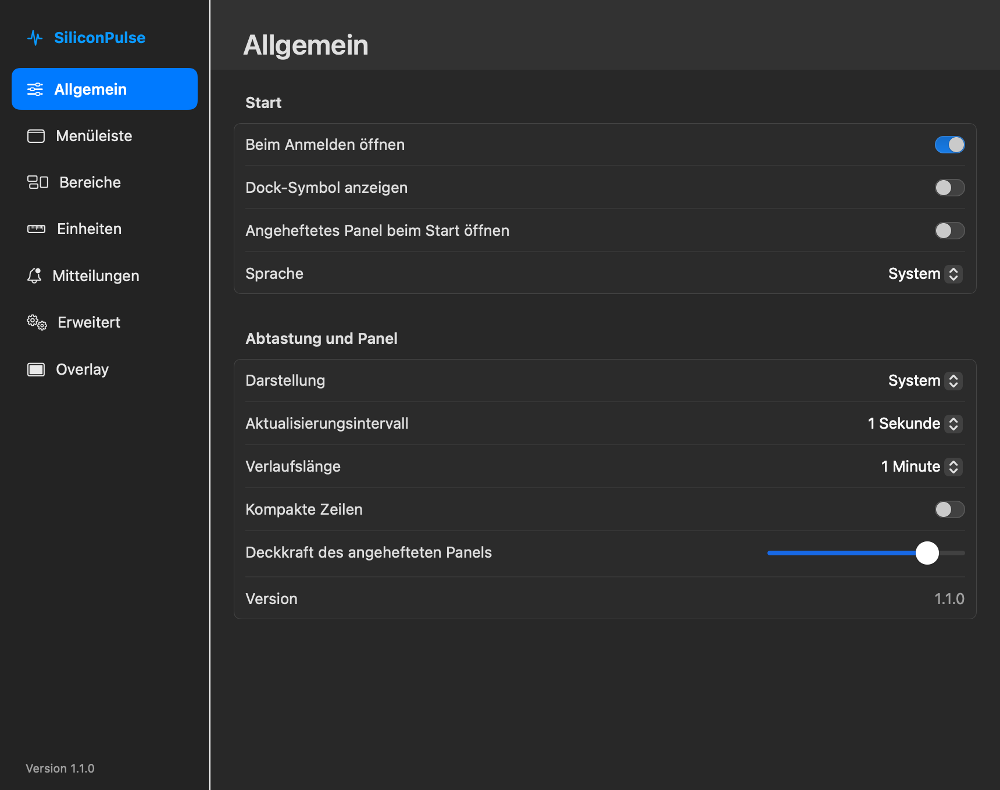

# SiliconPulse

Live-Telemetrie für Apple Silicon in deiner Menüleiste.


[](https://github.com/leonsuv/SiliconPulse/releases/latest)
[](https://github.com/leonsuv/SiliconPulse/releases)
[](https://github.com/leonsuv/SiliconPulse)
[](https://github.com/leonsuv/SiliconPulse)
[](LICENSE)
[](https://github.com/leonsuv/SiliconPulse/actions/workflows/build.yml)

SiliconPulse ist ein nativer macOS-Menüleistenmonitor für Apple Silicon. Dashboard und optionales Overlay zeigen Batterie, CPU, GPU, Leistung, Arbeitsspeicher, Datenträger, Netzwerk und Temperaturzustand.

- Kein sudo und kein privilegierter Helfer erforderlich.
- SwiftUI, AppKit und Swift Charts ohne Drittanbieterpakete.
- Das Dashboard misst nur, solange es sichtbar ist. Im geschlossenen Zustand misst die App Batterie und ausgewählten Menüleistenwert alle fünf Sekunden.


## Monitorfenster

**Details** im Panel oder **Monitor öffnen …** im Menü öffnet das neue, vergrößerbare Monitorfenster. Die Menüleisten-App bleibt erhalten.

- Übersicht und Leistungsansichten für CPU, E-/P-Kerne, GPU, Speicher, SSD, Netzwerk, Energie und Temperaturen.
- Prozessliste, Prozessbaum, Filter, Benutzersummen und Details. Eigene Prozesse lassen sich nach Bestätigung beenden.
- Hardwareinformationen, Autostart und launchd-Dienste; geschützte macOS-Dienste bleiben unveränderbar.
- Sensortabelle mit Minimum/Maximum, Apple-Silicon-Kernverläufe und verfügbare Frequenzen/Verweildauern.
- Lokale Aufzeichnung mit Export, Zeitleiste und Wiedergabe. Netzwerkverbindungen einschließlich TCP, UDP und lokaler IPC.
- Installierte Apps, Größenberechnung, zugehörige Dateien und bestätigtes Verschieben in den Papierkorb. Treiberinformationen und Finder-Aktionen.
- Ordneranalyse mit Flächenkarte/Kreisen, Suche, größten Dateien, Dateitypen und gespeicherten Scans.
- Lokale CPU-, Metal-GPU- und SSD-Benchmarks, optionaler Internettest sowie ein ausdrücklich nicht standardisierter SiliconPulse-Index.

Messwerte hängen von macOS und Hardware ab. Nicht verfügbare Werte erscheinen als **n/a**; es gibt keine Beispielwerte oder Pro-Sperren. Internettests übertragen Daten und starten ausschließlich per Schaltfläche.

Das Monitorfenster misst nur, solange es geöffnet ist. Eine ausdrücklich gestartete Aufzeichnung läuft auch bei geschlossenem Fenster weiter. Administratorrechte sind für Messungen nicht erforderlich; einzelne Änderungen an systemweiten Diensten oder am Energiesparmodus können eine macOS-Administratorabfrage benötigen.

Die Speicheranalyse nutzt den MIT-lizenzierten Scanner aus [FastTree](https://github.com/leonsuv/FastTree), die Socketabfrage verwendet Ansätze aus [PortPeek](https://github.com/leonsuv/PortPeek). Private IOReport-Aufrufe bleiben in einer Datei. CLPC-Zählerkennungen und DVFS-Protokolldaten folgen der dokumentierten [macmon-Recherche](https://github.com/vladkens/macmon); macmon-Code wurde nicht übernommen.

## Screenshots

<picture>
  <source media="(prefers-color-scheme: dark)" srcset="docs/assets/screenshots/dashboard-wide-dark.png">
  
</picture>

| Kompaktes Panel | Leistung im Detail | Einstellungen |
|---|---|---|
|  |  |  |

Die Screenshots zeigen die echten App-Views mit lokal gemessenen Werten. Messwerte variieren je nach Mac und Zeitpunkt. Hell/Dunkel lässt sich unter **Allgemein → Darstellung** wählen.

## Installation

1. Lade [SiliconPulse-1.1.0.zip](https://github.com/leonsuv/SiliconPulse/releases/latest/download/SiliconPulse-1.1.0.zip) aus den GitHub Releases herunter.
2. Entpacke die Datei und verschiebe `SiliconPulse.app` nach `/Applications`.
3. Die App ist ad-hoc signiert und nicht notarisiert. Klicke beim ersten Start mit gedrückter Ctrl-Taste auf die App und wähle **Öffnen** oder nutze **Systemeinstellungen → Datenschutz & Sicherheit → Dennoch öffnen**. Alternativ kannst du das Quarantäne-Attribut entfernen:

   ```sh
   xattr -dr com.apple.quarantine /Applications/SiliconPulse.app
   ```

## Aus dem Quellcode bauen

Voraussetzungen: Apple-Silicon-Mac, macOS 14 oder neuer und Swift 5.9 oder neuer.

```sh
git clone https://github.com/leonsuv/SiliconPulse.git
cd SiliconPulse
./build.sh
open SiliconPulse.app
```

Das Skript baut das Swift-Paket, erstellt ein `LSUIElement`-App-Bundle, kopiert Symbol und Sprachressourcen und signiert ad hoc. App Sandbox ist nicht aktiviert.

## Verwendung

- Klicke auf das Statussymbol, um das Dashboard zu öffnen oder zu schließen. In den Einstellungen wählst du die Menüleistenwerte aus.
- Heft das Fenster an, damit es bei App-Wechseln und Spaces sichtbar bleibt. Ziehe den Kopfbereich zum Verschieben und den Griff zum Ändern der Größe.
- Im Bearbeitungsmodus kannst du Karten sortieren und ein- oder ausblenden. Ein Klick auf den Kartentitel klappt sie auf oder zu.
- Einstellungen lassen sich über das Zahnrad, das Rechtsklickmenü des Statussymbols und „Overlay-Einstellungen“ öffnen, solange das Overlay aktiv ist.
- Das gestrichelte Rechteck aktiviert das klickdurchlässige Overlay. Der Standardkurzbefehl ist **Ctrl–Option–O** und lässt sich unter Einstellungen → Overlay ändern.
- **Momentaufnahme kopieren** kopiert eine kurze Zusammenfassung. Mit **Beenden** schließt du die App.

## Messwerte und Datenquellen

| Messwert | Quelle | Hinweise |
|---|---|---|
| Batterieladung, Zustand, Kapazitäten, Zyklen, Spannung, Strom und Temperatur | IOKit-Registry `AppleSmartBattery` | Zustand = NominalChargeCapacity ÷ DesignCapacity. Fehlende Werte ergeben `n/a`. |
| CPU-Last und Nutzung pro Kern | Mach `host_processor_info`; `hw.perflevel*`-Sysctls | Clustername und Anzahl kommen vom System. |
| GPU-Last, Renderer, Tiler, Speicher und Kernanzahl | IOKit-Registry `AGXAccelerator` | Fehlende Services oder Schlüssel ergeben `n/a`. |
| CPU-, GPU-, ANE- und DRAM-Leistung | Dynamisch geladene private `IOReport`-Symbole | Fehlende Symbole oder Zähler ergeben `n/a`. |
| Speicherbelegung, Wired-Speicher, Komprimierung, Cache und Druck | Mach-VM-Statistiken und Speicherdruckmeldungen | Activity-Monitor-ähnliche Aufteilung. |
| Startvolume | Foundation-Volume-Werte | SMART-Status wird lokal mit `diskutil` gelesen. |
| Datenträgerdurchsatz und IOPS | IOKit-Statistiken von `IOBlockStorageDriver` | Beim ersten Messpunkt oder Zählerreset ist keine Rate verfügbar. |
| Netzwerkdurchsatz | Interface-Zähler aus `getifaddrs` | Zählt `en*`-Interfaces und ermittelt keine lokalen Interface-IP-Adressen. |
| WLAN-Signal, Kanal und Linkrate | CoreWLAN | Die SSID wird nicht gelesen. WLAN muss verfügbar sein. |
| Temperatur und Lüfter | Modellabhängige HID- und AppleSMC-Registry-Schnittstellen | Werte können fehlen und lassen sich in den erweiterten Einstellungen abschalten. |
| CPU und Speicher der Prozesse | `proc_listallpids` und `proc_pidinfo` | Die Prozessliste wird nur bei geöffnetem Dashboard aktualisiert. |
| Ruhezustandsblocker | IOPM-Assertion-APIs | Zeigt Prozesse mit aktiven Energie-Assertions. |
| Thermischer Zustand, Chip, Modell, Kerne, Laufzeit und macOS | `ProcessInfo`, `sysctl` und Foundation | Einzelne Werte können fehlen. |
| Netzwerklatenz | Optionale Latenzmessung | Sendet nur bei Aktivierung eine TCP-Anfrage an den eingestellten Host. Standardmäßig aus. |

`IOReport` und manche Sensorleser verwenden private, modellabhängige Schnittstellen, die sich mit macOS ändern können. Nicht verfügbare Werte erscheinen als `n/a`; die App schätzt nichts.

## Datenschutz und Sicherheit

Die Telemetrie bleibt auf dem Mac. SiliconPulse liest keine SSIDs oder Seriennummern, ermittelt keine lokalen Interface-IP-Adressen und sendet keine Analysedaten. Netzwerkdurchsatz stammt aus lokalen Interface-Zählern. Netzwerkanfragen werden nur gesendet, wenn die optionale Latenzmessung aktiviert ist. Mitteilungen sind lokale macOS-Mitteilungen. sudo, privilegierter Helfer und App-Sandbox-Berechtigungen sind nicht erforderlich.

## Kompatibilität

SiliconPulse benötigt macOS 14 oder neuer und Apple Silicon. Gebaut und ausprobiert wurde es auf Apple Silicon mit macOS 27.0; andere unterstützte Versionen wurden nicht vollständig getestet. Batteriewerte, WLAN, Temperatur, Lüfter, private IOReport-Kanäle und Bluetooth-Akkudaten hängen von Modell und Systemversion ab. Intel-Macs werden nicht unterstützt.

## Leistung

Die folgenden Messungen stammen von einem Apple-Silicon-Mac mit diesem Release-Kandidaten. Je Zustand wurde der App-Prozess nach zwei Sekunden Startzeit 20 Sekunden lang beobachtet. RSS bezeichnet den belegten residenten Speicher. Andere Systeme können abweichen.

| Zustand | CPU | Speicher (RSS) |
|---|---:|---:|
| Nur Menüleiste | 0,29 % | 127,5 MiB |
| Overlay (ohne Sparklines, 2 s Aktualisierung) | 1,86 % | 128,6 MiB |
| Angeheftetes Fenster | 6,04 % | 144,5 MiB |

## Häufige Fragen

**Warum ist ein Messwert `n/a`?** Der Registry-Schlüssel, private Zähler oder die Systemschnittstelle ist auf diesem Mac oder macOS eventuell nicht verfügbar. Die App erfindet keine Messwerte.

**Warum ist CPU-Leistung manchmal null oder nicht verfügbar?** IOReport-Kanäle und Zähler variieren. Fehlende Kanäle ergeben `n/a`; ein unveränderter Zähler kann null melden.

**Warum ist der Download nicht notarisiert?** Das Release-Zip ist ad-hoc signiert. Für Notarisierung ist ein Apple-Developer-Konto erforderlich; dieser Release enthält sie nicht.

**Wie beende ich die App?** Wähle **SiliconPulse beenden** im Statusmenü oder klicke im Fenster auf **Beenden**.

**Wie setze ich Einstellungen zurück?** Öffne Einstellungen → Erweitert → **Alle Einstellungen zurücksetzen**. Im Bearbeitungsmodus gibt es außerdem **Layout zurücksetzen**.

**Funktioniert das Overlay in exklusiven Vollbild-Apps?** Das Overlay nutzt ein schwebendes macOS-Fenster. Apps mit exklusivem Vollbild können andere Fenster ausblenden. Nutze bei Bedarf randloses Fenstervollbild.

## Lizenz

SiliconPulse steht unter der [MIT-Lizenz](LICENSE).

## Oberfläche prüfen

```sh
./build.sh
./scripts/check-interface.sh
```

Rendert das kompakte und breite Panel sowie alle sieben Einstellungsbereiche in Hell/Dunkel aus den App-Views. Vorhandene Einstellungen werden nach dem Prüflauf wiederhergestellt.

[UI validation](docs/UI-VALIDATION.md) · [Changelog](CHANGELOG.md)
