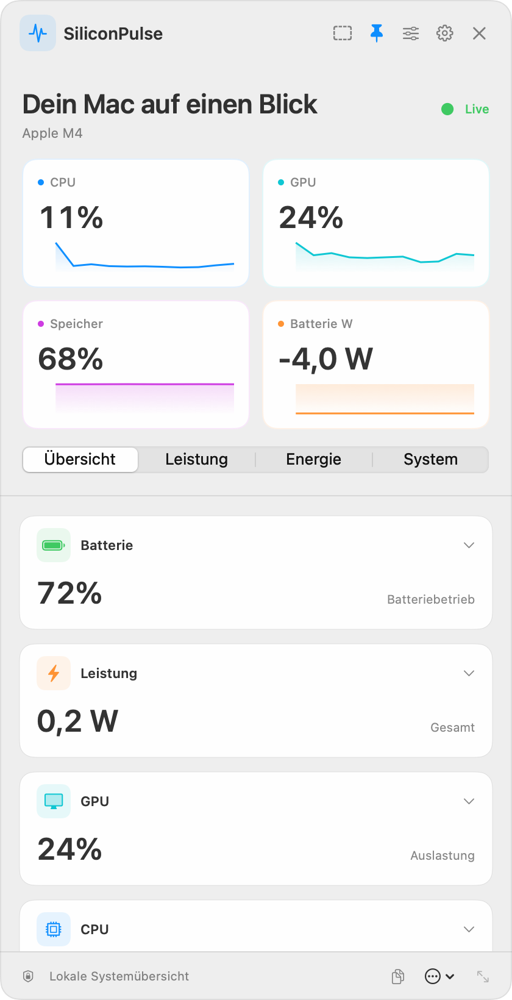
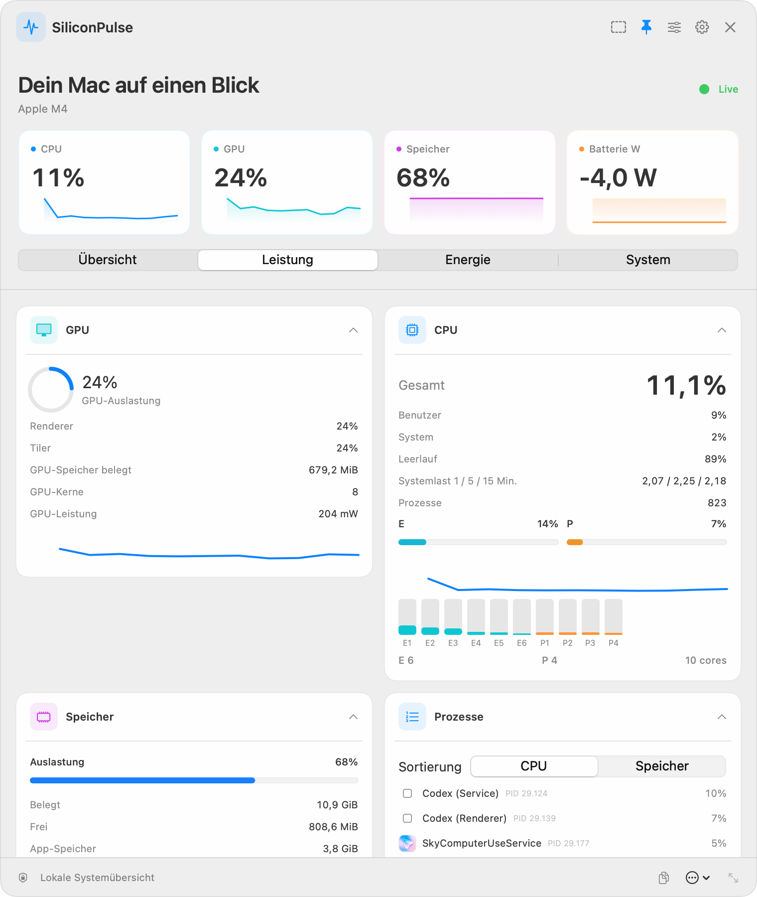
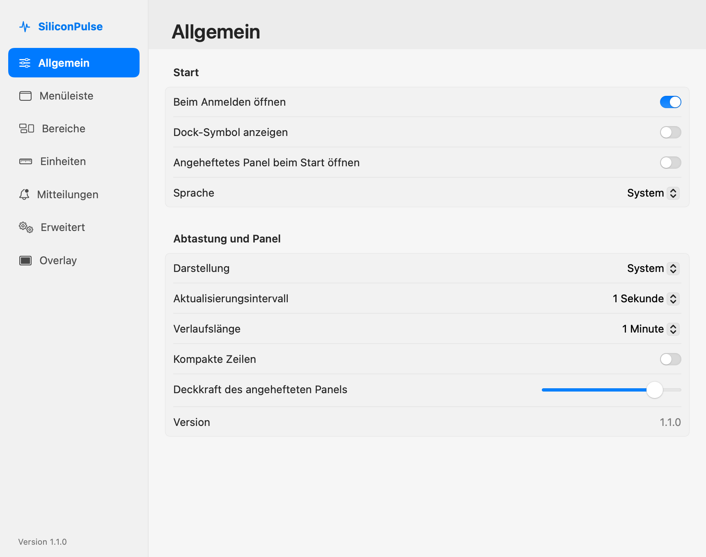

# SiliconPulse

Live Apple Silicon telemetry in your menu bar.


[](https://github.com/leonsuv/SiliconPulse/releases/latest)
[](https://github.com/leonsuv/SiliconPulse/releases)
[](https://github.com/leonsuv/SiliconPulse)
[](https://github.com/leonsuv/SiliconPulse)
[](LICENSE)
[](https://github.com/leonsuv/SiliconPulse/actions/workflows/build.yml)

SiliconPulse is a native macOS menu bar monitor for Apple Silicon. Its dashboard and optional overlay show battery, CPU, GPU, power, memory, storage, network and thermal readings.

- No sudo or privileged helper is required.
- SwiftUI, AppKit and Swift Charts; no third-party packages.
- The dashboard samples while visible. When it is closed, the app samples the battery and selected menu bar metric every five seconds.

## Screenshots

<picture>
  <source media="(prefers-color-scheme: dark)" srcset="docs/assets/screenshots/dashboard-wide-dark.png">
  
</picture>

| Compact panel | Performance details | Settings |
|---|---|---|
|  |  |  |

Screenshots show the production app views with real locally sampled telemetry. Readings vary by Mac and time. Choose System, Light, or Dark under **General → Appearance**.

## Install

1. Download [SiliconPulse-1.1.0.zip](https://github.com/leonsuv/SiliconPulse/releases/latest/download/SiliconPulse-1.1.0.zip) from GitHub Releases.
2. Unzip it and move `SiliconPulse.app` to `/Applications`.
3. The app is ad-hoc signed and not notarized. On first launch, Control-click it and choose **Open**, or use **System Settings → Privacy & Security → Open Anyway**. Alternatively, remove quarantine yourself:

   ```sh
   xattr -dr com.apple.quarantine /Applications/SiliconPulse.app
   ```

## Build from source

Requirements: an Apple Silicon Mac, macOS 14 or later, and Swift 5.9 or later.

```sh
git clone https://github.com/leonsuv/SiliconPulse.git
cd SiliconPulse
./build.sh
open SiliconPulse.app
```

The script builds the Swift package, assembles an `LSUIElement` app bundle, copies its local icon and language resources, and ad-hoc signs the app. App Sandbox is not enabled.

## Use SiliconPulse

The overview shows the key readings. Expand a card for details, or select Performance, Energy, or System. Pinned panels use two columns at widths of 560 points and above.


- Click the status item to open or close the dashboard. Settings lets you choose which readings appear in the menu bar.
- Pin the panel to keep it visible across app changes and Spaces. Drag its header to move it and use the resize handle to change its size.
- Use Edit mode to reorder cards or change which cards appear. Click a card header to expand or collapse it.
- Open Settings from the gear, the status item context menu, or Overlay Settings in that menu while the overlay is active.
- Use the dashed rectangle to turn on the click-through overlay. Its default shortcut is **Control–Option–O** and can be changed under Settings → Overlay.
- **Copy snapshot** copies a short summary; **Quit** exits the app.

## Metrics and data sources

| Metric | Source | Notes |
|---|---|---|
| Battery charge, state, capacities, cycle count, voltage, current and temperature | IOKit `AppleSmartBattery` registry properties | Health is NominalChargeCapacity ÷ DesignCapacity. Missing values show `n/a`. |
| CPU load and per-core use | Mach `host_processor_info`; `hw.perflevel*` sysctls | Cluster names and counts come from the system. |
| GPU load, renderer, tiler, memory and core count | IOKit `AGXAccelerator` registry properties | Missing services or keys show `n/a`. |
| CPU, GPU, ANE and DRAM power | Private `IOReport` symbols loaded dynamically | Missing symbols or counters show `n/a`. |
| Memory use, wired, compression, cache and pressure | Mach VM statistics and memory pressure notifications | Uses Activity Monitor style accounting. |
| Boot volume space | Foundation volume resource values | SMART status is read locally with `diskutil`. |
| Disk read/write throughput and IOPS | IOKit `IOBlockStorageDriver` statistics | A first sample or reset counter has no rate. |
| Network throughput | `getifaddrs` interface counters | Counts `en*` interfaces and does not enumerate local interface IP addresses. |
| Wi-Fi signal, channel and link rate | CoreWLAN | SSID is not read. Values depend on the Wi-Fi interface. |
| Temperature and fan speed | Model-dependent HID and AppleSMC registry interfaces | Readings can be unavailable and can be disabled in Advanced settings. |
| Process CPU and memory | `proc_listallpids` and `proc_pidinfo` | The process list is sampled only while the dashboard is open. |
| Sleep blockers | IOPM assertion APIs | Reports processes with active power assertions. |
| Thermal state, chip, model, cores, uptime and macOS | `ProcessInfo`, `sysctl` and Foundation | Individual values can be unavailable. |
| Network latency | Optional latency probe | When enabled, sends a TCP request to its configured host. It is off by default. |

`IOReport` and some sensor readers use private, model-dependent interfaces that can change with macOS. SiliconPulse shows `n/a` when a reading is unavailable and does not estimate values.

## Privacy and security

Telemetry stays on the Mac. SiliconPulse does not read SSIDs or serial numbers, does not enumerate local interface IP addresses, and sends no analytics. Network throughput comes from local interface counters. Network requests are made only when the optional latency probe is enabled. Notifications are local macOS notifications. The app does not require sudo, a privileged helper or App Sandbox entitlements.

## Compatibility

SiliconPulse requires macOS 14 or later and Apple Silicon. It was built and exercised on Apple Silicon running macOS 27.0; other supported releases have not all been tested. Battery keys, Wi-Fi information, temperature, fans, private IOReport channels and Bluetooth battery data vary by model and OS. Intel Macs are not supported.

## Performance

Measurements below are from an Apple Silicon Mac running this release candidate. Each is a 20-second sample of the app process after a two-second startup settle; RSS is resident memory. They are observations, not guarantees for other systems.

| State | CPU | Memory (RSS) |
|---|---:|---:|
| Menu bar only | 0.29% | 127.5 MiB |
| Overlay only (sparklines off, 2 s refresh) | 1.86% | 128.6 MiB |
| Pinned panel | 6.04% | 144.5 MiB |

## FAQ

**Why does a metric show `n/a`?** Its registry key, private counter or system interface may be unavailable on this Mac or macOS version. The app does not invent values.

**Why is CPU power sometimes zero or unavailable?** IOReport channel names and counters vary. Missing channels show `n/a`; a counter that does not change can report zero.

**Why is the download not notarized?** The release zip is ad-hoc signed. Notarization requires an Apple Developer account and is not part of this release.

**How do I quit?** Choose **Quit SiliconPulse** from the status item menu or use **Quit** in the panel footer.

**How do I reset settings?** Open Settings → Advanced and choose **Reset all settings**. Edit mode also has **Reset layout**.

**Does the overlay work in exclusive full-screen apps?** It uses a macOS floating window. Apps using exclusive full-screen presentation may hide other windows; use borderless or windowed full screen if it is not visible.

## License

SiliconPulse is available under the [MIT License](LICENSE).

## Interface verification

```sh
./build.sh
./scripts/check-interface.sh
```

Renders the compact and wide panels and all seven settings sections in light and dark from the app views. The run restores existing preferences afterward.

[UI validation](docs/UI-VALIDATION.md) · [Changelog](CHANGELOG.md)
